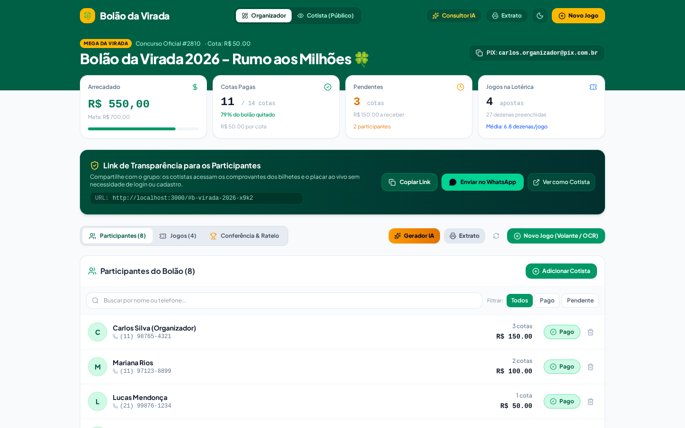
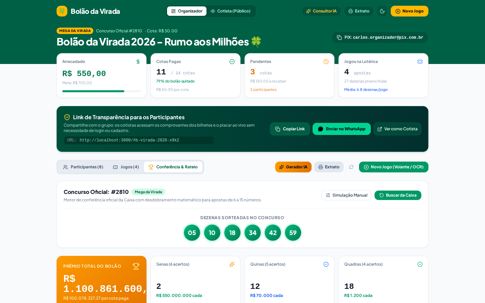
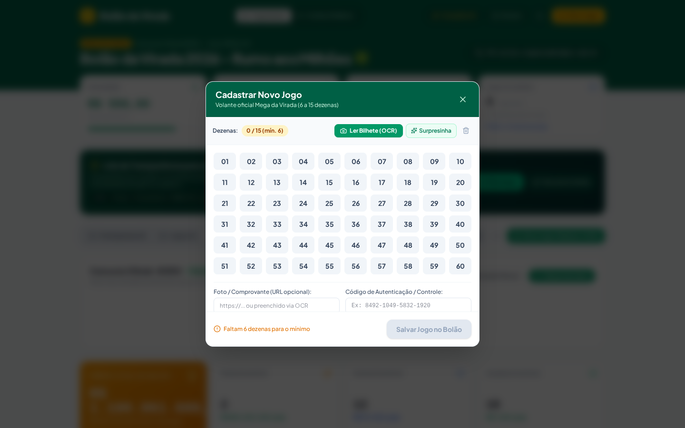
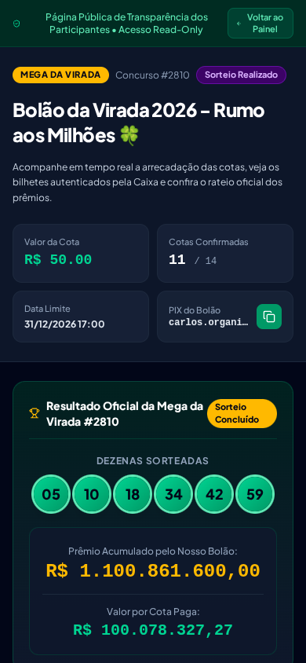

# Bolão da Virada — Gestão, OCR e Transparência

> Plataforma web moderna e responsiva (Mobile-First / PWA) para organização de bolões da Mega da Virada entre amigos, familiares e colegas de trabalho, com foco em automação, auditoria de bilhetes via OCR, inteligência de apostas e transparência financeira.

[](https://bolao-da-virada-hazel.vercel.app)
[](https://react.dev/)
[](https://www.typescriptlang.org/)
[](https://tailwindcss.com/)
[](https://vitejs.dev/)
[](./src/utils/lotteryEngine.test.ts)

---

## 🌐 Acesso Online em Produção

Aplicação publicada e hospedada na Vercel:
👉 **[https://bolao-da-virada-hazel.vercel.app](https://bolao-da-virada-hazel.vercel.app)**

---

## 🎯 Visão Geral das Funcionalidades

- **Dashboard do Organizador**:
  - Resumo financeiro em tempo real (Total Arrecadado, Meta Potencial, Cotas Pagas vs. Pendentes).
  - Gestão de cotistas com toggle rápido de status (`"Marcar como Pago"` ⇄ `"Pago"`).
  - Cópia da chave PIX em 1 clique e disparo de convites pré-formatados com emojis para WhatsApp.

- **Volante Numérico Interativo (01 a 60)**:
  - Seleção visual de 6 a 15 dezenas com validação estrita das regras da Caixa Econômica Federal.
  - Função *Surpresinha* para geração aleatória instantânea.
  - Indicador de multiplicador e custo proporcional oficial da aposta.

- **Leitor OCR de Bilhetes Térmicos**:
  - Pré-processamento com Canvas de alta definição (binarização e filtro de contraste).
  - Extração automática de dezenas a partir de fotos de comprovantes térmicos da lotérica.
  - Upload e visualização ampliada do comprovante oficial para auditoria de autenticidade da Caixa.

- **Consultor Estatístico & Gerador IA**:
  - Geração de apostas balanceadas (proporção par/ímpar histórica).
  - Análise de cobertura da cartela com diagnóstico de dezenas faltantes e concentração em quadrantes.

- **Conferência ao Vivo & Rateio Oficial**:
  - Apuração em tempo real após a divulgação das dezenas sorteadas.
  - Cálculo exato de **desdobramentos da Caixa** ($C(m,k) \times C(n-m, 6-k)$) para apostas de 7 a 15 dezenas.
  - Regra de proteção jurídica: rateio restrito exclusivamente aos participantes com cotas quitadas antes do sorteio.

- **Visão Pública de Transparência do Cotista**:
  - Link público seguro com **zero cadastro/login** para os participantes acessarem direto pelo WhatsApp.
  - Anonimização de telefones em conformidade com a **LGPD** (`(11) 9****-1234`).
  - Inspeção fotográfica de todos os bilhetes registrados.

- **Extrato Timbrado de Prestação de Contas**:
  - Geração de extrato em PDF/Impressão (`Ctrl + P`) pronto para arquivo ou envio aos participantes.

- **Guia Jurídico & FAQ Integrado**:
  - Explicação do enquadramento legal como SaaS (prestação de serviços de TI/software) de acordo com o Decreto-Lei nº 204/1967 e Lei nº 13.756/2018.

---

## 📸 Telas da Aplicação

Consulte o documento completo com as 11 telas detalhadas:
👉 **[Ver Galeria Completa de Telas](./docs/screens_overview.md)**

| Dashboard do Organizador | Conferência & Rateio |
| :---: | :---: |
|  |  |

| Volante Numérico Interativo | Visão Pública Mobile |
| :---: | :---: |
|  |  |

---

## 🛠️ Tecnologias Utilizadas

- **Frontend**: React 19, TypeScript, Tailwind CSS v4, Lucide React, Motion.
- **Build Tool**: Vite 8.
- **Armazenamento**: LocalStorage com sincronização reativa e suporte a API REST.
- **Processamento de Imagem**: Canvas 2D nativo (binarização, limiarização por Otsu e extração de padrões térmicos).
- **Testes**: Node.js Test Runner com execução via `tsx`.

---

## 🚀 Como Executar Localmente

### Pré-requisitos
- Node.js (versão 20 ou superior recomendada)
- Git

### Passo a Passo

1. **Clone o repositório:**
   ```bash
   git clone https://github.com/KCdoTI/Bolao-da-Virada.git
   cd Bolao-da-Virada
   ```

2. **Instale as dependências:**
   ```bash
   npm install --legacy-peer-deps
   ```

3. **Configure as variáveis de ambiente (opcional):**
   ```bash
   cp .env.example .env
   ```

4. **Inicie o servidor de desenvolvimento:**
   ```bash
   npm run dev
   ```
   Acesse a aplicação em `http://localhost:5173`.

---

## 🧪 Executando os Testes

O projeto conta com suíte de testes unitários para o motor combinatório lotérico, regras da Caixa, sanitização LGPD e IA:

```bash
npx --yes tsx --test src/utils/lotteryEngine.test.ts src/utils/aiStrategyEngine.test.ts
```

---

## ⚖️ Conformidade Legal e Modelo de Negócio

Para entender a viabilidade jurídica, normas da Caixa Econômica Federal e o porquê da escolha do **Web App / PWA** em detrimento de aplicativos em lojas (App Store / Google Play), consulte o estudo completo:
👉 **[Documento de Pesquisa, Viabilidade e Regras](./docs/PESQUISA_VIABILIDADE_E_REGRAS.md)**.

---

## 📄 Licença

Distribuído sob a licença MIT. Veja `LICENSE` para mais detalhes.
