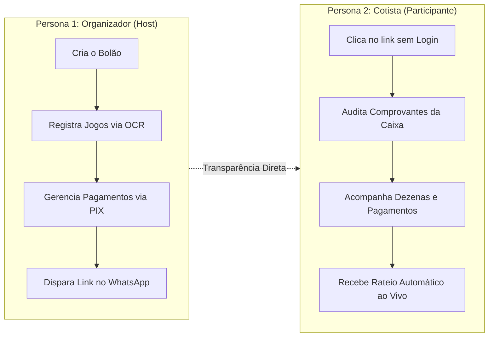
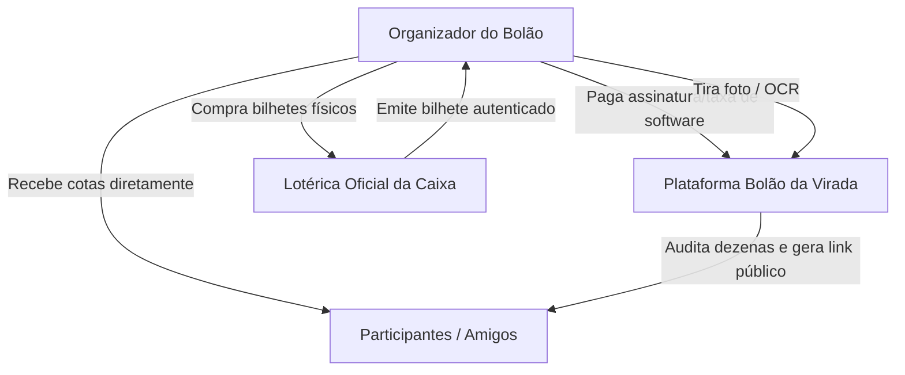
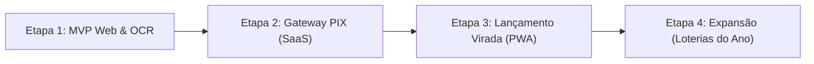

# Estudo de Viabilidade, Usabilidade, Regras de Negócio e Licenciamento
## Projeto: Bolão da Virada (Gestão, OCR e Transparência)

---

## 1. Pesquisa de Usabilidade e Experiência do Usuário (UX/UI)

### 1.1. Contexto Cultural e Problema Central
No Brasil, organizar bolões da Mega da Virada entre amigos, familiares e colegas de trabalho é uma tradição cultural massiva. No entanto, o processo tradicional sofre de graves atritos operacionais e relacionais:
- **Desconforto na cobrança**: O organizador precisa cobrar individualmente cada participante e controlar quem pagou em blocos de notas ou planilhas confusas.
- **Risco de fraude e desconfiança**: O participante comum muitas vezes se pergunta:
  - *"O organizador realmente registrou as apostas na lotérica antes do sorteio?"*
  - *"Quantas cotas foram vendidas de fato? Meu prêmio será diluído sem eu saber?"*
  - *"Quais foram exatamente os números jogados?"*
- **Digitação manual exaustiva**: Cadastrar manualmente 10 a 30 bilhetes contendo dezenas numéricas é demorado e sujeito a erros humanos graves.
- **Cálculo de desdobramento no Réveillon**: Jogos com mais de 6 dezenas (7 a 15 números) pagam **múltiplos prêmios** (ex: um jogo de 7 dezenas que acerta 5 ganha 2 Quinas e 5 Quadras). Fazer essa conta manualmente durante a festa de Réveillon é impraticável e gera conflitos.

---

### 1.2. Mapeamento das Personas

#### Persona 1: O Organizador (Host)
- **Perfil**: Aquele que toma a iniciativa de criar o grupo no WhatsApp da família ou do trabalho.
- **Objetivos**: Economizar tempo, manter transparência para evitar desconfianças, controlar o caixa sem estresse.
- **Soluções de UX adotadas**:
  - **Dashboard com KPIs Financeiros**: Total arrecadado, meta potencial, percentual de quitação e total de dezenas.
  - **Alternador Rápido com 1 Toque**: Botão para marcar `"Marcar como Pago"` ⇄ `"Pago"` instantaneamente.
  - **Leitor OCR por Câmera Traseira**: Extrai números de 01 a 60 direto do cupom térmico impresso em menos de 5 segundos.
  - **Consultor IA & Gerador Estratégico**: Sugere combinações equilibradas e analisa a cobertura da cartela.
  - **Disparo no WhatsApp com Emojis**: Monta mensagens completas pré-formatadas para cópia e envio em 1 clique.

#### Persona 2: O Cotista (Participante / Convidado)
- **Perfil**: O amigo ou colega que comprou 1 ou mais cotas.
- **Objetivos**: Ter certeza absoluta de que suas apostas foram feitas, ver os números e saber o valor exato a receber caso ganhem.
- **Soluções de UX adotadas**:
  - **Zero-Login / Zero-Cadastro**: Não exige download de app pesado nem criação de conta/senha. Basta clicar no link seguro (`/b/hash-id`).
  - **Auditoria Visual do Bilhete**: Modal de alta resolução para conferir a foto física do comprovante oficial autenticado pela Caixa.
  - **Privacidade LGPD**: Telefones são ofuscados no padrão `(11) 9****-1234`, impedindo a exposição de dados sensíveis entre cotistas que não se conhecem.
  - **Extrato Financeiro ao Vivo**: Apuração instantânea pós-sorteio com cálculo exato do prêmio por cota paga.

---

### 1.3. Decisões Ergonômicas (Mobile-First Touch Design)
1. **Grid do Volante Adaptativa**: Em telas de smartphones (375px a 430px), o volante utiliza grade de 6 colunas (`grid-cols-6`) para garantir áreas de toque de pelo menos $44 \times 44\text{px}$, evitando toques acidentais em números vizinhos. Em telas de computador, expande para 10 colunas (`sm:grid-cols-10`).
2. **Bottom Sheet & Modais**: Modais sobem a partir da base da tela no celular, respeitando a zona de alcance natural do polegar.
3. **Contrastes e Feedback Imediato**: Notificações *Toast* e *Optimistic UI* fornecem retorno visual imediato a qualquer ação (cópia de PIX, alternância de pagamento ou salvamento de aposta).

---

## 2. Regras de Negócio e Motor Lotérico Oficial

### 2.1. Regras Oficiais da Mega da Virada (Caixa Econômica Federal)
- **Dezenas Válidas**: Números inteiros entre **01 e 60**.
- **Tamanho da Aposta Simples**: 6 números.
- **Tamanho de Apostas Múltiplas**: De 7 até 15 números (ou até 20 números nas regras estendidas da Caixa).
- **Sem Acumulação**: A Mega da Virada **não acumula**. Se não houver acertadores de 6 dezenas (Sena), o prêmio principal é rateado entre os acertadores de 5 dezenas (Quina), e sucessivamente.
- **Distribuição percentual padrão do prêmio líquido arrecadado**:
  - Faixa 1 (6 acertos - Sena): 62%
  - Faixa 2 (5 acertos - Quina): 19%
  - Faixa 3 (4 acertos - Quadra): 19%

---

### 2.2. O Desdobramento Matemático de Apostas Múltiplas
Quando uma aposta é feita com mais de 6 dezenas, o apostador paga o valor proporcional a todas as combinações simples de 6 números contidas no volante. Se essa aposta for premiada, ela **recebe múltiplos prêmios**:

$$\text{Qtd de Prêmios de faixa } k = C(m, k) \times C(n - m, 6 - k)$$

Onde:
- $n$ = Quantidade de números marcados na aposta ($6 \le n \le 15$);
- $m$ = Quantidade de dezenas acertadas no sorteio ($0 \le m \le 6$);
- $k$ = Faixa de premiação avaliada ($k = 6$ para Sena, $k = 5$ para Quina, $k = 4$ para Quadra);
- $C(a, b) = \frac{a!}{b!(a - b)!}$ (Combinação Simples).

#### Exemplos Reais de Multiplicadores da Caixa:
- **Aposta de 7 números com 5 acertos**:
  - Senas: $C(5,6) = 0$
  - Quinas: $C(5,5) \times C(7-5, 6-5) = 1 \times C(2,1) =$ **2 Quinas**
  - Quadras: $C(5,4) \times C(7-5, 6-4) = 5 \times C(2,2) =$ **5 Quadras**
- **Aposta de 8 números com 6 acertos**:
  - Senas: $C(6,6) \times C(8-6, 0) =$ **1 Sena**
  - Quinas: $C(6,5) \times C(8-6, 1) = 6 \times 2 =$ **12 Quinas**
  - Quadras: $C(6,4) \times C(8-6, 2) = 15 \times 1 =$ **15 Quadras**

*O motor `lotteryEngine.ts` implementa essa fórmula combinatória com exatidão.*

---

### 2.3. Regra de Rateio Financeiro e Segurança Jurídica
- **Inadimplência**: Apenas cotas com status `"Pago"` no momento do sorteio entram no cálculo da divisão. Cotas com status `"Pendente"` são isoladas do rateio financeiro para proteger os cotistas que efetivamente custearam os bilhetes.
- **Divisão Proporcional**:
  $$\text{Valor do Cotista} = \text{Qtd de Cotas Pagas do Cotista} \times \left( \frac{\text{Prêmio Total do Bolão}}{\text{Total de Cotas Pagas}} \right)$$

---

## 3. Análise Jurídica, Regulatória e Licenciamento no Brasil

### 3.1. Marco Legal Brasileiro sobre Loterias e Apostas
A legislação brasileira sobre jogos de azar e loterias é rigorosa:
1. **Decreto-Lei nº 204/1967**: Institui o monopólio da União sobre a exploração de loterias federais.
2. **Lei nº 13.756/2018**: Disciplina a destinação da arrecadação das loterias e a operação pela Caixa Econômica Federal.
3. **Lei de Contravenções Penais (Decreto-Lei nº 3.688/1941, Art. 50 e 51)**: Tipifica como contravenção a exploração ou realização de jogos de azar ou loterias não autorizadas por lei federal.
4. **Lei nº 14.790/2023 (Secretaria de Prêmios e Apostas - SPA/MF)**: Regulamenta as apostas esportivas de quota fixa e jogos online ("Bets"), **mas não autoriza empresas privadas a emitirem ou operarem bilhetes de loteria numérica federal (Mega-Sena, Quina, etc.)**.

---

### 3.2. Posicionamento Jurídico: O que é PROIBIDO vs. O que é PERMITIDO

| Atividade | Classificação Legal | Risco | Permitido no App? |
|---|---|---|---|
| **Intermediação de Apostas com Cobrança de Taxa por Bilhete** (ex: o app recolhe dinheiro, vai na lotérica e cobra 20% de serviço) | Ilegal sem credenciamento oficial da Caixa Econômica Federal | **ALTÍSSIMO** (Inquéritos da CEF, Ministério Público, Procon) | **NÃO** |
| **Retenção de Custódia Financeira** (o dinheiro das cotas cai na conta bancária da empresa dona do app) | Exige autorização de Instituição de Pagamento perante o Banco Central | **ALTO** | **NÃO** |
| **Cobrança de Comissão sobre o Prêmio Ganho ("Success Fee")** | Ilegal. Configura participação em exploração de loteria clandestina | **ALTÍSSIMO** | **NÃO** |
| **Software SaaS de Gestão, OCR e Transparência** (o app é uma ferramenta de produtividade, como o Notion ou Trello; o organizador arrecada o PIX diretamente e compra os bilhetes físicos por conta própria) | **100% Legal** (Prestação de serviços de software / TI - CNAE 62.01-5-01 / 62.02-3-00) | **BAIXO / SEGURO** | **SIM (MODELO ADOTADO)** |

---

### 3.3. Modelo de Negócio Viável e Monetização Segura

Para comercializar a plataforma sem violar a legislação brasileira, adota-se o modelo **SaaS (Software as a Service) puro**:

#### Planos de Monetização Recomendados:
1. **Plano Gratuito (Freemium)**:
   - Até 1 bolão ativo com até 5 participantes e 3 jogos registrados.
   - Excelente para aquisição viral e atração de novos usuários.
2. **Plano Organizador Pro (Cobrança por Evento / One-Off)**:
   - Valor: **R$ 9,90 a R$ 19,90 por bolão**.
   - Participantes ilimitados, leitura OCR ilimitada via IA, gerador estratégico com estatísticas históricas, exportação de extrato timbrado em PDF para prestação de contas.
3. **Plano Firma / Empresa (Anual)**:
   - Valor: **R$ 49,90/ano**.
   - Para quem organiza bolões recorrentes (Mega da Virada, Dupla de Páscoa, Quina de São João, Lotofácil da Independência).

---

## 4. Comparativo de Distribuição: App Store / Play Store vs. Navegador (Web App / PWA)

Uma das decisões estratégicas mais críticas para o sucesso do projeto é onde disponibilizar a aplicação:

| Critério de Análise | Apple App Store (iOS Nativo) | Google Play Store (Android Nativo) | Navegador Web (Responsive Web App / PWA) |
|---|---|---|---|
| **Atrito para o Participante** | **Péssimo**: O amigo no grupo do WhatsApp precisa baixar um app de 60MB, criar conta Apple ID e autorizar downloads para ver 1 bilhete. | **Ruim**: Precisa baixar o APK ou instalar via loja. | **PERFEITO (Zero Atrito)**: Clica no link do WhatsApp e abre instantaneamente em 0,5s no Safari/Chrome sem instalar nada. |
| **Aprovação e Políticas de Lojas** | **Risco Crítico**: A Diretriz 5.3.4 da Apple proíbe apps relacionados a loteria com dinheiro real a menos que publicados pelo próprio governo/Caixa. Rejeição ou banimento frequente. | **Risco Alto**: Política estrita de *Gambling, Games, and Contests*. Requer documentação regulatória complexa. | **ZERO RISCO**: Total independência de políticas de moderação das big techs. |
| **Taxas de Monetização** | **15% a 30%** para a Apple em compras In-App. | **15% a 30%** para o Google. | **0% para lojas**. Taxas apenas de gateway de pagamento (ex: 0,99% em PIX via Asaas, Mercado Pago ou Stripe). |
| **Velocidade de Deploy** | **Lenta**: Revisões manuais demoram de 1 a 5 dias. Inviável para correções de última hora perto das 20h do dia 31 de dezembro. | **Média**: 12h a 48h para liberação de atualizações. | **INSTANTÂNEA**: Atualizações publicadas no servidor ficam disponíveis em segundos para todos os usuários. |
| **Custo de Manutenção** | Alto (requer conta Apple Developer US$ 99/ano + Swift/React Native). | Médio (conta Google Play US$ 25 taxa única + Kotlin/React Native). | Baixo (código único em TypeScript + Tailwind + React, servido universalmente). |
| **Instalação no Celular** | Automática via loja. | Automática via loja. | Suporta PWA ("Adicionar à Tela de Início"), gerando ícone nativo sem passar pela loja. |

---

### 4.1. Veredito Técnico e Estratégico: Por que o Navegador (PWA) é Superior

1. **A dinâmica do bolão é viral e instantânea**: No dia 30 e 31 de dezembro, o organizador envia uma mensagem no grupo do WhatsApp da família ou do escritório. Mais de 80% das pessoas vão apenas **acompanhar**. Se essas pessoas precisarem baixar um aplicativo nativo nas lojas, **95% desistirão** no primeiro clique.
2. **Independência Regulatória**: As políticas da Apple e do Google frequentemente bloqueiam ou suspendem sumariamente aplicativos que usam palavras como "Loterias", "Apostas", "Premiação" ou "Mega-Sena", mesmo quando são apenas utilitários de gestão. Rodar na Web garante **100% de disponibilidade contínua**.
3. **PWA (Progressive Web App)**: O organizador que desejar ter o ícone do aplicativo fixado na tela inicial do celular pode simplesmente tocar em *"Adicionar à Tela Inicial"*, ganhando comportamento de aplicativo nativo (tela cheia, cache offline, acesso rápido à câmera para OCR e Web Share API).

---

## 5. Matriz de Recomendações e Próximos Passos

### Síntese Executiva
- **Pode comercializar?** **SIM**, desde que monetizado estritamente como **Software SaaS / Ferramenta de Gestão** (cobrando pela licença de uso do software, OCR e consultoria estatística), **sem** intermediar o dinheiro das apostas e **sem** cobrar porcentagem sobre prêmios.
- **Lojas ou Navegador?** **NAVEGADOR (Web App / PWA)**. É a abordagem mais ágil, sem risco de rejeição na App Store, com atrito zero para os cotistas no WhatsApp e sem cobrança da comissão de 30% da Apple e Google.
