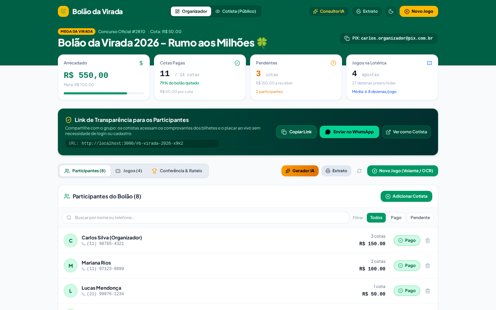
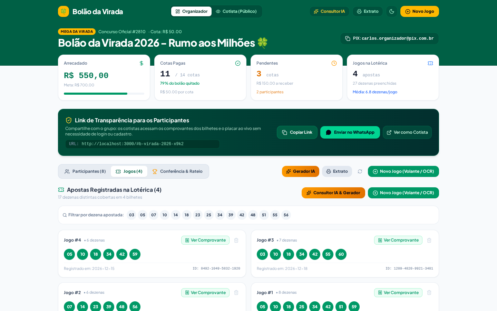
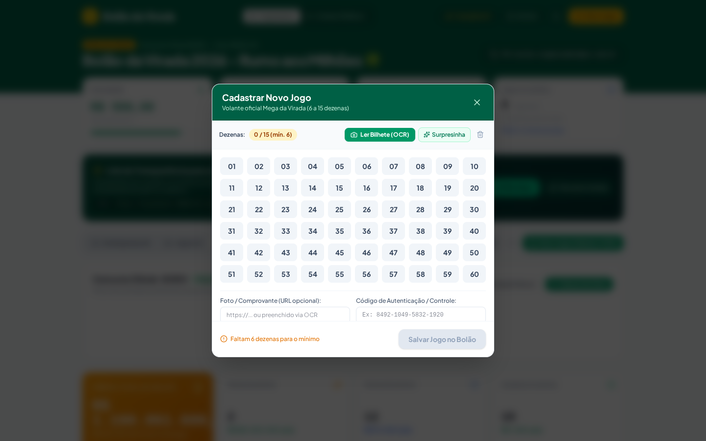
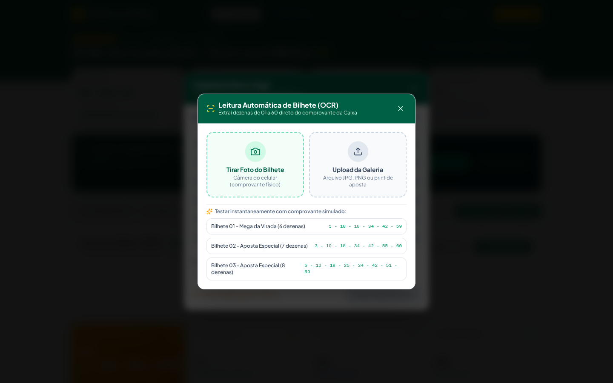
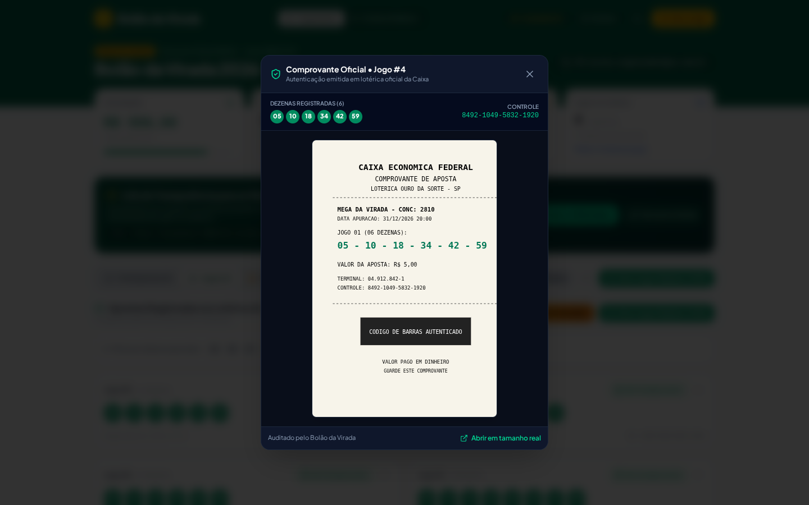
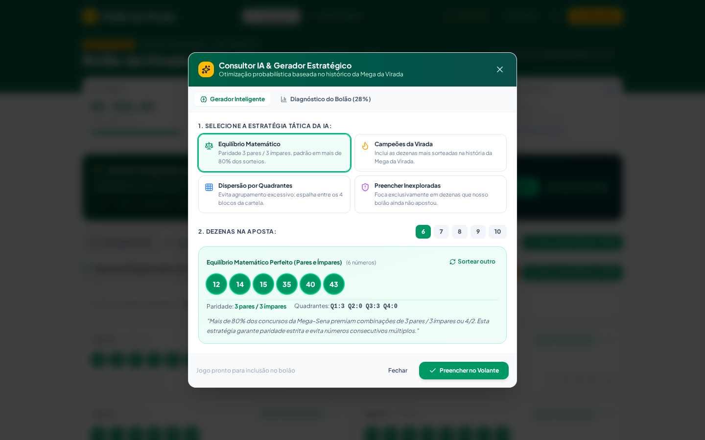
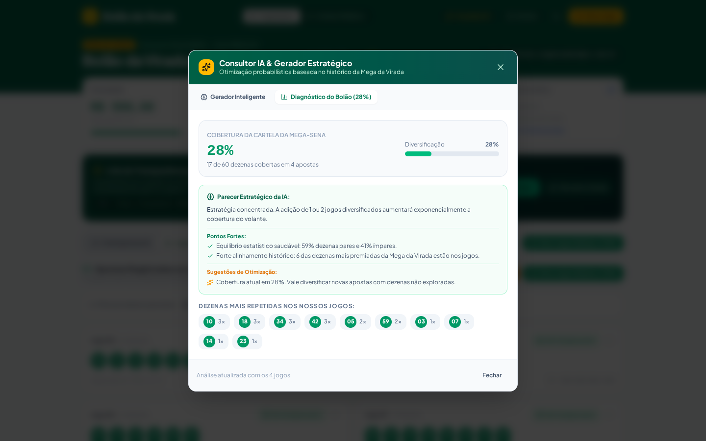
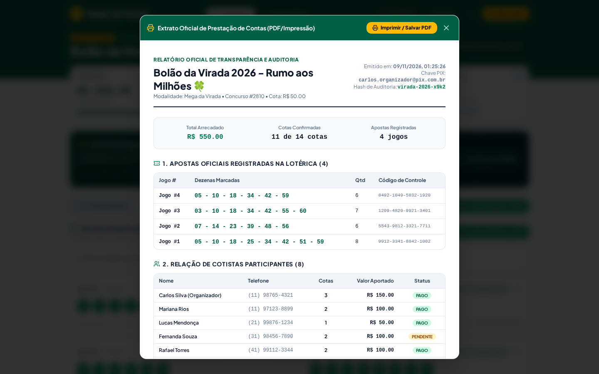
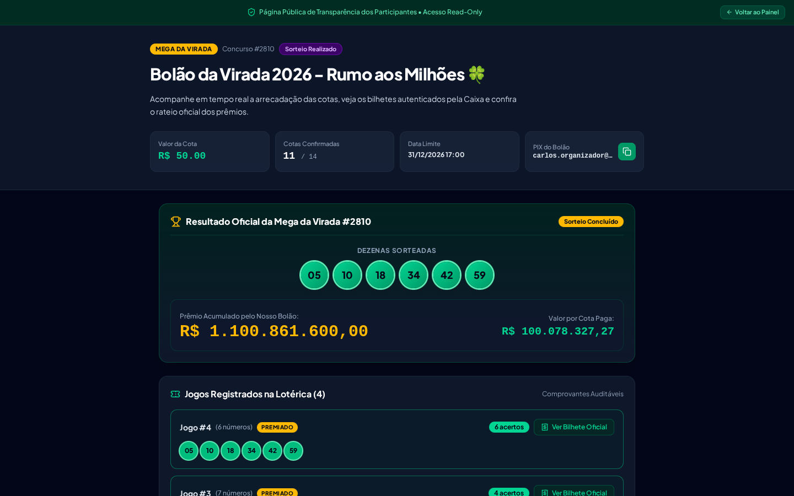
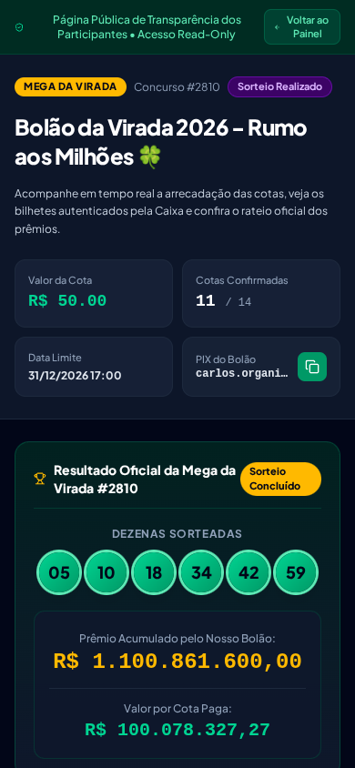

# Galeria Visual de Telas e Auditoria de UX/UI
## Projeto: Bolão da Virada (Gestão, OCR e Transparência)

Este documento reúne os prints em alta definição de todas as telas e fluxos do **Bolão da Virada**, demonstrando o design responsivo, a ergonomia mobile-first, a integração com Inteligência Artificial e a total transparência para o cotista.

---

### 1. Painel Principal do Organizador
Visão geral do bolão com **3 Zonas Estritas**: Header com chave PIX e atalhos rápidos, Cards de KPIs Financeiros (Total Arrecadado, Meta, Quitação) e Tabela de Cotistas com botão de 1 clique para marcar como `"Pago"`.

---

### 2. Gestão e Filtro de Jogos Registrados
Listagem de apostas cadastradas com visualização em badges circulares verdes, contador de acertos em tempo real e barra de busca interativa para filtrar jogos por dezena específica.

---

### 3. Conferência ao Vivo & Rateio Oficial
Painel de apuração pós-sorteio com cálculo automático de desdobramentos de apostas de 6 a 15 dezenas e divisão estrita apenas entre cotistas com pagamento quitado.

---

### 4. Volante Numérico Interativo
Interface inspirada no volante oficial da Mega-Sena (01 a 60), com grade ergonômica, contador de dezenas selecionadas (6 a 15), botão Surpresinha aleatória e aviso de custo proporcional da Caixa.

---

### 5. Leitor OCR de Bilhete Térmico
Módulo de visão computacional com Canvas local para binarização de imagem (preto e branco de alto contraste), remoção de ruídos e extração de dezenas sem necessidade de digitação manual.

---

### 6. Auditoria de Comprovante Autenticado
Modal de inspeção visual do comprovante emitido pela casa lotérica, contendo número do terminal, autenticação digital e código de segurança para auditoria por qualquer participante.

---

### 7. Consultor Estratégico & Gerador IA
Módulo de inteligência que analisa combinações matemáticas e permite gerar apostas otimizadas com perfis: **Balanceada (3P/3I)**, **Estatística (Frequentes)**, **Fechamento de Quadrantes** ou **Desdobramento Especial de 7 Dezenas**.

---

### 8. Diagnóstico de Cobertura Estatística
Relatório visual que audita todo o conjunto de apostas cadastradas no bolão: dezenas únicas cobertas de 1 a 60, taxa de cobertura percentual, equilíbrio par/ímpar e lista de dezenas ainda descobertas.

---

### 9. Extrato Timbrado de Prestação de Contas
Extrato completo com formatação pronta para impressão ou exportação em PDF (`Ctrl + P` / `@media print`), contendo identificação do bolão, lista de cotistas, tabela de bilhetes autenticados e termo de quitação para arquivo do organizador.

---

### 10. Visão Pública do Cotista (Desktop)
Interface pública acessada pelos cotistas via link seguro compartilhado no WhatsApp. Não exige login nem senha, preserva a privacidade dos números de telefone conforme a LGPD e disponibiliza a foto de cada bilhete.

---

### 11. Visão Pública do Cotista (Mobile - 375px)
Experiência do usuário em smartphones (iPhone / Android). Design fluido, botões em área de fácil alcance pelo polegar, cartões condensados e navegação limpa para consulta rápida durante o sorteio de Réveillon.

